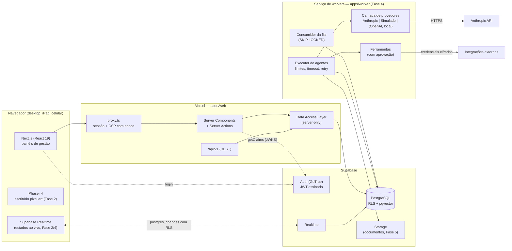
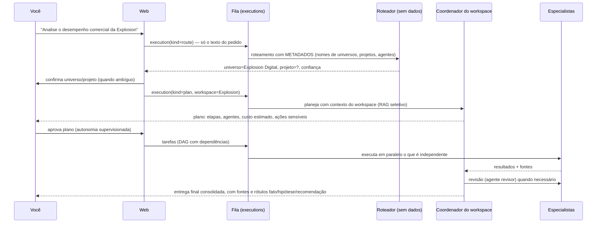

# MY OFFICE AI — Arquitetura

> Documento vivo. Última revisão: 07/11/2026 (Fase 0 + Fase 1).
> Decisões detalhadas e alternativas descartadas: [docs/DECISIONS.md](docs/DECISIONS.md).

## 1. O que é (e o que não é)

O MY OFFICE AI é uma **infraestrutura pessoal e empresarial de agentes de IA** com um escritório em pixel art como
experiência central. O dono da conta é o administrador; os agentes são a equipe digital.

Princípios que guiam todas as decisões:

| Princípio | Consequência técnica |
|---|---|
| Infraestrutura, não agentes fixos | Agentes, departamentos, categorias, perfis de agente e ferramentas são **dados** (linhas no banco), criados pela interface. Nenhum agente é codificado no app. |
| Dois universos isolados | A unidade de isolamento é o **workspace** (`pessoal` ou `empresarial`). O isolamento é aplicado **no banco** (RLS), não só na interface. |
| Execução real | Todo estado “trabalhando” de um personagem corresponde a uma linha `executions` com status `running` e a uma chamada real a um provedor de IA ou ferramenta. Sem animação de trabalho fictício. |
| Autonomia supervisionada | Ações sensíveis passam por `approvals`, vinculadas ao *hash* da ação exata e expiram quando o contexto muda. |
| Honestidade de dados | Indicadores vêm do banco. Dados de exemplo e o provedor simulado são sempre rotulados como tal. |
| Simplicidade sem atalhos de segurança | Poucos serviços no MVP (Vercel + Supabase + 1 worker). Redis/BullMQ só se a fila no Postgres não der conta. |

## 2. Visão geral



**Fluxo de uma requisição autenticada (Fase 1, já implementado):**

1. `proxy.ts` cria um cliente `@supabase/ssr` com `getAll`/`setAll`, chama `auth.getClaims()` (renova o token se
   preciso e grava os cookies na resposta) e redireciona para `/entrar` quem não tem sessão.
2. A página (Server Component) chama a DAL. A DAL obtém as *claims* verificadas (`getClaims()` valida a assinatura do
   JWT pelo JWKS do projeto) e abre uma transação no Postgres com:
   `set_config('request.jwt.claims', <claims>, true)` e `set local role authenticated`.
3. Toda consulta dessa transação passa pelas políticas RLS — exatamente como passaria pela API REST do Supabase.
   Um erro de programação na aplicação não consegue ler dados de outro workspace, porque o banco recusa.

## 3. Componentes e estrutura de diretórios

Monorepo `pnpm` (workspaces). Pacotes internos são consumidos como código-fonte TypeScript (sem etapa de build).

```
my-office-ai/
├── ARCHITECTURE.md  ROADMAP.md  DATABASE.md  SECURITY.md  README.md
├── docs/
│   └── DECISIONS.md                 registro de decisões (ADRs)
├── apps/
│   ├── web/                         Next.js 16 (App Router) — UI + BFF  [Fase 1]
│   │   ├── src/proxy.ts             sessão Supabase, proteção de rotas, CSP com nonce
│   │   ├── src/app/                 rotas: (auth), (app)/inicio, (app)/w/[workspaceId]/…, configuracoes
│   │   ├── src/server/              server-only: env, auth, DAL, ações (validação Zod)
│   │   ├── src/components/          shell (barra lateral, seletor de universo), ui
│   │   └── e2e/                     Playwright + emulador do protocolo Supabase Auth (só testes)
│   └── worker/                      processo Node contínuo: fila, execução, provedores  [Fase 4]
├── packages/
│   ├── core/                        domínio puro: universos, papéis, estados, políticas, schemas Zod  [Fase 1]
│   ├── db/                          schema Drizzle, cliente com contexto RLS, migrador, testes de isolamento  [Fase 1]
│   ├── ai/                          interface de provedor, Anthropic, Simulado, preços  [Fase 4]
│   └── tools/                       catálogo de ferramentas, executores, cifragem de credenciais  [Fase 6]
├── supabase/
│   ├── config.toml                  configuração do Supabase CLI (ambiente local)
│   ├── migrations/                  SQL versionado — fonte da verdade do banco
│   └── hardening/                   SQL opcional de endurecimento (papel de conexão dedicado)
├── scripts/                         banco local para desenvolvimento/testes
└── .github/workflows/ci.yml         tipos, lint, unitários, RLS no Postgres, build, E2E, Supabase real
```

### 3.1 `apps/web` (Vercel)

- **Server Components + Server Actions** para a interface; **REST `/api/v1`** para clientes externos (n8n, Obsidian
  companion, futuro app) a partir da Fase 4.
- **Data Access Layer** (`src/server/dal/*`, marcada `server-only`): único lugar que fala com o banco. Recebe o usuário
  autenticado, valida entrada com Zod, devolve DTOs mínimos. Segue a recomendação de segurança da documentação do
  Next 16 (`guides/data-security.md`).
- Nunca executa trabalho longo: no máximo enfileira (`insert into executions`) e retorna.
- Segredos (chave da Anthropic, chave de cifragem) **não existem** no app web; ficam no worker.

### 3.2 `apps/worker` (serviço contínuo — Fase 4)

Processo Node 22 em contêiner (Railway, Render, Fly.io ou VM gratuita). Loop:

1. **Reivindica** trabalho: `update executions set status='running', lease_owner=$w, lease_expires_at=now()+'60s'
   where id in (select id from executions where status='queued' and run_after<=now() and <limites de concorrência>
   order by priority, created_at for update skip locked limit $n) returning *`.
2. **Executa** sob `withAgentContext(owner, agentId)` — mesmas políticas RLS, restritas ao universo do agente e às
   concessões explícitas (ver §5).
3. **Registra** cada passo em `execution_events` (Realtime entrega à interface) e o consumo em `usage_records`.
4. **Heartbeat** renova o *lease*; um *reaper* devolve à fila execuções com *lease* vencido (recuperação de falhas).
5. **Retry** com backoff exponencial e limite (`attempt < max_attempts`); **timeout** por execução; **cancelamento**
   cooperativo (`cancel_requested_at`); **idempotência** por `idempotency_key` única.
6. Antes de cada chamada externa verifica: parada de emergência, orçamento, profundidade de delegação, número de
   chamadas e aprovação vigente.

### 3.3 `packages/core`

Domínio puro e testável, sem I/O: tipos e catálogos (universos, papéis, estados de agente, módulos de navegação,
categorias iniciais), regras (quem pode o quê), validação de entrada (Zod). Na Fase 4 recebe as máquinas de estado de
tarefas/execuções e o catálogo de ações sensíveis.

### 3.4 `packages/db`

- `schema.ts`: tabelas em Drizzle (consultas tipadas) **espelhando** as migrations SQL. Um teste de deriva compara o
  schema Drizzle com o banco real para impedir divergência.
- `client.ts`: `withUserContext(claims, fn)` e `withAgentContext(claims, agentId, fn)` — as únicas portas de entrada
  para dados de usuário. O cliente “privilegiado” (sem RLS) fica em um *entrypoint* separado usado só pelo migrador
  e pelo worker para operações de sistema.
- `migrate.ts`: aplica `supabase/migrations/*.sql` em ordem, registrando na mesma tabela que o Supabase CLI usa
  (`supabase_migrations.schema_migrations`), então os dois caminhos são intercambiáveis.

### 3.5 `packages/ai` (Fase 4)

```ts
interface AIProvider {
  id: 'anthropic' | 'simulated' | 'openai' | 'local'
  listModels(): ModelInfo[]                     // inclui preço por milhão de tokens
  generate(req: GenerateRequest): Promise<GenerateResult>   // streaming interno, retorna mensagem final + usage
}
```

- **Anthropic** (primeiro provedor) via `@anthropic-ai/sdk`, com streaming para respostas longas, *prompt caching* do
  prefixo estável (sistema + ferramentas) e tratamento de `stop_reason` (`refusal`, `max_tokens`, `tool_use`).
- **Simulado**: modo de desenvolvimento sem custo. Toda saída vem marcada `[SIMULADO]`, os personagens exibem um selo
  “simulado” e os indicadores separam esse consumo. Nunca é usado em produção sem rótulo.
- Cada agente escolhe provedor + modelo; limites de tokens e orçamento por agente/workspace.

### 3.6 `packages/tools` (Fase 6)

Catálogo de ferramentas como dados (`tools`), com `sensitivity` (`internal`, `sensitive`, `critical`) e
`requires_approval`. Executores por integração. Credenciais cifradas (AES-256-GCM, chave só no worker). Integração sem
credencial = status **desconectada**, visível na interface; nenhuma integração fictícia.

## 4. Universos, workspaces e escritório

```
Usuário (dono)
├── Workspace PESSOAL (1 por usuário)           cor: verde
│   ├── Categorias (8 iniciais, criação livre)
│   │   └── Departamentos → Projetos → Tarefas
│   ├── Agentes (pertencem a 1 workspace)
│   └── Memória do universo pessoal
└── Workspaces EMPRESARIAIS (N: Explosion Digital, …)   cor: roxo
    └── (mesma estrutura, isolada por empresa)

Escritório (visão do usuário, consolidada)
└── Salas (configuráveis) → podem apontar para um departamento de um workspace do qual o usuário é membro
```

- **Workspace** é a fronteira de isolamento. Duas empresas também ficam isoladas entre si.
- O **escritório** é uma visão do *usuário*: mostra salas e personagens de todos os universos em que ele é membro.
  Isso é permitido porque é o humano olhando; não concede nada aos agentes.
- Salas padrão (Fase 2): Recepção, Sala de comando, Departamento pessoal, Departamento empresarial, Sala de reuniões,
  Laboratório de pesquisa, Desenvolvimento, Centro de operações, Arquivo e biblioteca, Lounge. Todas editáveis.

## 5. Modelo de isolamento (três camadas, todas no banco)

1. **Associação ao workspace** — `app.is_member(ws)`: o usuário só enxerga workspaces dos quais é membro.
2. **Contexto de agente** — quando o worker executa um agente, define `myoffice.agent_id` na transação. As funções
   `app.can_read(ws)` / `app.can_write(ws)` passam a exigir que o workspace seja **o do agente** ou que exista uma
   **concessão explícita** (`access_grants`) ativa, não revogada e não expirada. O contexto de agente só **restringe**:
   nunca amplia o que o dono já pode ver.
3. **Concessões explícitas e registradas** — `access_grants` só é criada/revogada por funções que exigem dono/admin
   dos dois lados, gravam `reason`, autor, validade e auditoria. Agentes não têm permissão de escrita em
   `agents`, `access_grants` nem `workspace_members` (não alteram as próprias permissões).

Os testes de isolamento (`packages/db/test/rls.test.ts`) verificam essas regras com usuários de teste reais no
PostgreSQL.

## 6. Central de comando e Coordenador (Fase 4)



- O **roteamento** vê apenas metadados (nomes, especialidades), nunca documentos — assim um pedido ambíguo não vaza
  conteúdo entre universos.
- O **Coordenador** é um agente como os outros (perfil “principal”), um por workspace, criado na Fase 4. Pode
  **sugerir** novos agentes; a criação exige sua aprovação.
- Limites anti-loop: profundidade máxima de delegação, número máximo de chamadas por execução raiz, tempo total e
  custo total (`executions.root_execution_id` agrega).

## 7. Execução e concorrência

| Requisito | Mecanismo |
|---|---|
| Fila | Tabela `executions` + `FOR UPDATE SKIP LOCKED` (ADR-005) |
| Paralelismo | Tarefas sem dependências pendentes são reivindicadas por vários workers/slots |
| Limite de concorrência | Global (por processo), por workspace e por agente (consulta de contagem na reivindicação) |
| Timeout | `timeout_seconds` por execução + `AbortController` na chamada ao provedor |
| Retry | `attempt`/`max_attempts`, backoff exponencial em `run_after`, só para erros transitórios (429, 5xx, rede) |
| Cancelamento | `cancel_requested_at`; o worker verifica entre passos e aborta a chamada em curso |
| Recuperação | *lease* + heartbeat; *reaper* devolve execuções órfãs |
| Idempotência | `idempotency_key` única; efeitos externos registram a chave e não repetem |
| Rastreamento | `execution_events` (sequência por execução), `messages`, `usage_records`, `audit_logs` |
| Documentos | coluna `version` (lock otimista) + `pg_advisory_xact_lock` por documento durante escrita de agente |
| Emergência | `profiles.emergency_stop_at` / `workspaces.paused_at`: o worker para de reivindicar e cancela em curso |

## 8. Escritório pixel art (Fase 2)

- **Phaser 4** carregado só no cliente (`dynamic import`, sem SSR) dentro de um componente React. React é dono dos
  dados; Phaser só desenha o que recebe.
- O mapa é gerado a partir de `office_rooms` (posição, tamanho, tema, mobília). Personagens a partir de `agents`
  (aparência em `avatar`) e do estado real (`agents.status` + execução corrente). Atualizações por Supabase Realtime,
  com *polling* como reserva.
- Comportamentos visuais por estado: trabalhando → sentado ao computador; pesquisando → estante/arquivo; em reunião →
  sala de reuniões; ocioso → parado/circulando no lounge; concluído → apresentando; aguardando aprovação → ícone de
  bloqueio na sala de comando. Sem execução real, nada de animação de trabalho.
- Arte própria (sprites desenhados para o projeto, paleta azul-marinho/verde/roxo). Nada copiado de outros produtos.
- **Celular**: em vez do mapa inteiro, painel de agentes e tarefas com mini-mapa opcional.

## 9. Memória e conhecimento (Fase 5)

- **Níveis**: global (do usuário, só acessível a agentes com permissão explícita), por universo/workspace, por
  projeto e por agente — tudo em `memories` com escopo explícito e as mesmas regras de RLS.
- **Documentos**: Supabase Storage (caminho `workspace_id/…`, políticas de Storage com a mesma regra de associação).
  Extração no worker (PDF, DOCX, planilhas, imagens com descrição por modelo multimodal), *chunking*, indexação.
- **Busca híbrida**: texto completo (`tsvector` em português) + vetorial (`pgvector`, HNSW), fundidas por RRF.
- **Embeddings sem custo por padrão**: modelo local no worker (ex.: `gte-small`, 384 dimensões) — a Anthropic não
  oferece embeddings; provedores pagos ficam opcionais (ADR-009).
- **RAG seletivo**: só os trechos relevantes e autorizados entram no contexto; cada trecho leva id de origem, e a
  resposta do agente marca **fato documentado / hipótese / recomendação** com citações.
- **Obsidian**: um *companion* local (CLI) que você roda no seu computador faz sincronização explícita do vault
  (somente leitura por padrão), com *hash* por arquivo, registro de alterações e resolução de conflitos. A nuvem nunca
  presume acesso aos seus arquivos e nada é reorganizado sem autorização.

## 10. Aprovações (Fase 6)

- Cada ação sensível gera `approvals` com: ação, agente, motivo, dados envolvidos, impacto, riscos.
- `action_hash = sha256(ferramenta + argumentos normalizados + destino + versão do contexto)`. Executar exige uma
  aprovação `approved`, não consumida, não expirada e com o **mesmo hash** — se qualquer argumento ou o contexto muda,
  a aprovação não vale. Uso único (`consumed_at`).
- Botões: aprovar, rejeitar, solicitar alteração. Botão de pausa por agente e parada de emergência global.

## 11. Tempo real

Supabase Realtime (`postgres_changes`) nas tabelas `agents`, `executions`, `execution_events`, `approvals`. O Realtime
verifica a RLS com o JWT do usuário, então cada navegador só recebe eventos dos próprios workspaces. Reserva: *polling*
de 5 s quando o canal cai.

## 12. Implantação (Fase 8)

| Peça | Onde | Observação |
|---|---|---|
| `apps/web` | Vercel (Root Directory `apps/web`) | variáveis: URL e chave publicável do Supabase, URL de conexão do banco |
| Banco, Auth, Storage, Realtime | Supabase Cloud | migrations aplicadas pelo CLI ou pelo migrador do repositório |
| `apps/worker` | contêiner em Railway/Render/Fly.io/VM | `ANTHROPIC_API_KEY`, chave de cifragem, URL do banco |
| CI | GitHub Actions | tipos, lint, testes, RLS, build, E2E, Supabase real |

O app funciona na nuvem sem o Claude Code aberto: a sessão de desenvolvimento só escreve código e envia ao GitHub.

## 13. Riscos técnicos

| Risco | Impacto | Mitigação |
|---|---|---|
| Vazamento entre universos por bug na aplicação | Alto | RLS no banco como barreira principal; testes de isolamento automatizados; DAL única |
| Conexão do app com papel privilegiado (sem RLS) por engano | Alto | Toda consulta passa por `withUserContext`; papel de conexão dedicado sem privilégios próprios (`supabase/hardening`) |
| *Prompt injection* em documentos/páginas | Alto | Conteúdo externo entra delimitado como dado; políticas no prompt de sistema; ferramentas sensíveis sempre exigem aprovação; agentes sem ferramentas de permissão |
| Loop de delegação / custo descontrolado | Alto | Limites de profundidade, chamadas, tempo e custo; orçamento por workspace; parada de emergência |
| Funções serverless da Vercel com tempo limitado | Médio | Nada longo no web; worker contínuo separado |
| Pausa do Supabase Free após 7 dias sem atividade | Médio | Worker mantém atividade ou plano Pro para uso contínuo |
| Pool de conexões em serverless | Médio | Pooler de transação do Supabase (porta 6543), `prepare: false`, pool pequeno |
| Next.js 16 / Phaser 4 recentes, APIs novas | Médio | Documentação embutida na versão instalada; versões fixas; CI |
| Realtime indisponível | Baixo | *Polling* de reserva |
| Custo da API de IA | Variável | Provedor simulado no desenvolvimento; *prompt caching*; modelo por agente; orçamentos |
| Este repositório ainda vive num branch órfão do repositório do Meu Banqueiro | Baixo | Mover para repositório próprio (1 comando, ver README) |

## 14. Custos operacionais estimados (referência nov/2026 — confirmar nas páginas oficiais)

| Item | MVP (uso pessoal) | Uso contínuo/empresarial |
|---|---|---|
| Supabase | Free: 500 MB de banco, 1 GB de arquivos, pausa após 7 dias inativo | Pro: US$ 25/mês |
| Vercel | Hobby: grátis, **apenas uso não comercial** | Pro: US$ 20/mês por membro (uso pela Explosion Digital é comercial) |
| Worker | Grátis em VM *always free* (mais trabalho) ou ~US$ 5/mês (Railway Hobby) | US$ 5–10/mês |
| Redis | Não usado (fila no Postgres) | — |
| Embeddings | Modelo local no worker: US$ 0 | Opcional pago |
| Domínio | opcional (~R$ 40/ano `.com.br`) | — |
| Anthropic API (por milhão de tokens, entrada/saída) | Opus 5.5 US$ 4 / 20 · Sonnet 5.5 US$ 2 / 10 · Haiku 5.5 US$ 0,10 / 0,50 | leitura de cache ≈ 10% do preço de entrada; API de lote −50% |

Ordem de grandeza da IA: uma tarefa de pesquisa típica (≈30 mil tokens de entrada, 4 mil de saída) custa ≈ US$ 0,20
no Opus 5.5, ≈ US$ 0,10 no Sonnet 5.5 e ≈ US$ 0,005 no Haiku 5.5. O orçamento por workspace/agente impede surpresas.
