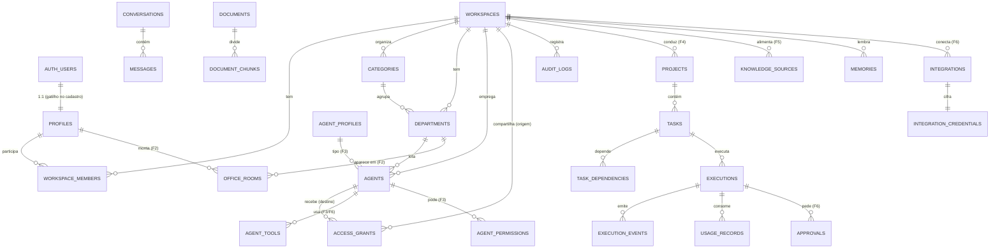

# MY OFFICE AI — Banco de dados

PostgreSQL (Supabase). **As migrations SQL em `supabase/migrations/` são a fonte da verdade**; o schema Drizzle em
`packages/db/src/schema.ts` espelha as tabelas para consultas tipadas e um teste de deriva impede divergência.

## 1. Convenções

- Identificadores `uuid` (`gen_random_uuid()`), estáveis e nunca reutilizados. Logs de alto volume usam `bigint identity`.
- Toda tabela de dados tem `workspace_id` (exceto as do próprio usuário) e **chaves estrangeiras compostas**
  `(x_id, workspace_id)` quando referenciam outra tabela do mesmo workspace — o banco impede que um departamento aponte
  para a categoria de outro universo.
- `created_at`/`updated_at` (`timestamptz`, gatilho `app.touch_updated_at`), `archived_at` para exclusão lógica.
- `created_by` preenchido por gatilho a partir do JWT (`auth.uid()`), nunca pelo cliente.
- Enums para conjuntos fechados e estáveis (tipo de universo, papel, estado do agente). Conjuntos que o usuário pode
  estender (perfis de agente, tipos de sala, ferramentas) são **tabelas**, não enums.
- Funções auxiliares no schema `app` (não exposto pela API REST do Supabase). Funções `security definer` usam
  `set search_path = ''` e nomes totalmente qualificados.
- Nada sensível em campos legíveis: credenciais ficam em `integration_credentials` (cifradas, sem acesso para
  `authenticated`).

## 2. Modelo de isolamento no banco

| Função | Significado |
|---|---|
| `auth.uid()` | Usuário do JWT verificado (definido pela aplicação/Supabase em `request.jwt.claims`) |
| `app.current_agent_id()` | Agente em execução (definido pelo worker em `myoffice.agent_id`); `null` = humano |
| `app.is_member(ws)` | O usuário é membro do workspace |
| `app.has_role(ws, papéis[])` | O usuário tem um dos papéis no workspace |
| `app.agent_can_read(ws)` | Sem agente → verdadeiro. Com agente → workspace do agente **ou** concessão ativa |
| `app.can_read(ws)` | `is_member(ws) and agent_can_read(ws)` |
| `app.can_write(ws)` | papel owner/admin/member **e** (humano **ou** agente do próprio workspace) |
| `app.can_manage(ws)` | papel owner/admin **e** humano (estrutura, permissões, agentes) |

Privilégios: o Supabase concede por padrão tudo em `public` a `anon` e `authenticated`. As migrations **revogam** isso
tabela a tabela e concedem só o necessário: `UPDATE` por coluna; `INSERT` na tabela, com o gatilho
`app.normalize_insert` sobrescrevendo as colunas protegidas (`created_by`, datas, `is_seed`, `status`) quando quem
insere é um usuário. `anon` não tem acesso a nenhuma tabela.

## 3. Diagrama (Fase 1 implementada + fases seguintes)

## 4. Tabelas da Fase 1 (implementadas — migration `20261107000100_foundation.sql`)

### `profiles` (usuários)
| Coluna | Tipo | Notas |
|---|---|---|
| id | uuid PK → `auth.users.id` | cascade ao excluir o usuário do Auth |
| display_name | text (1–80) | editável pelo próprio usuário (privilégio por coluna) |
| emergency_stop_at | timestamptz | parada de emergência global (usada pelo worker na Fase 4) |
| created_at, updated_at | timestamptz | |

RLS: o próprio usuário e quem divide um workspace com ele (para mostrar nomes de membros).

### `workspaces` (universos)
| Coluna | Tipo | Notas |
|---|---|---|
| id | uuid PK | |
| kind | `workspace_kind` (`personal` \| `business`) | |
| name | text (1–80) | |
| description | text (≤ 500) | |
| paused_at | timestamptz | pausa todas as execuções do workspace (Fase 4) |
| created_by | uuid → profiles | |
| created_at, updated_at, archived_at | timestamptz | |

Índice único parcial: **um workspace pessoal por usuário**. Criação só por funções (`app.provision_workspace` no
cadastro, `app.create_business_workspace` pela interface). RLS: leitura `can_read(id)`; atualização `can_manage(id)`
(apenas `name`, `description`).

### `workspace_members`
PK `(workspace_id, user_id)`, `role member_role` (`owner`, `admin`, `member`, `viewer`). Sem escrita direta na Fase 1
(convites virão com função própria) — impede autopromoção.

### `categories`
`workspace_id`, `name` (1–60, único por workspace entre as ativas), `description`, `icon`, `sort_order`, `is_seed`,
`created_by`, `archived_at`. Oito categorias iniciais por tipo de universo (tabela `app.category_templates`).
RLS: leitura `can_read`; criação/edição `can_manage`.

### `departments`
`workspace_id`, `category_id` (FK composta), `name`, `description`, `color`, `icon`, `sort_order`, `archived_at`.
Estrutura pronta; a interface de departamentos chega na Fase 2 junto com as salas.

### `agents` (núcleo; a Fase 3 acrescenta configuração completa)
`workspace_id` (universo autorizado), `department_id` (FK composta), `name`, `specialty`, `description`,
`status agent_status` (`available`, `planning`, `working`, `waiting_agent`, `waiting_approval`, `paused`, `done`,
`error`), `created_by`, `archived_at`. Escrita apenas por humanos com `can_manage`; agentes nunca escrevem aqui.

### `access_grants` (compartilhamento explícito entre universos)
| Coluna | Notas |
|---|---|
| source_workspace_id | dono dos dados compartilhados |
| grantee_workspace_id **ou** grantee_agent_id | exatamente um (CHECK) |
| resource_type / resource_id | `workspace` (todo o universo, leitura) agora; `category`, `project`, `document`, `memory` nas fases seguintes |
| permission | `read` (escrita entre universos não existe) |
| reason | obrigatório |
| granted_by, created_at, expires_at, revoked_at, revoked_by | rastreabilidade completa |

Sem privilégio de escrita para `authenticated`; criação e revogação por `app.grant_workspace_read` /
`app.revoke_access_grant`, que exigem dono/admin **dos dois lados**, recusam contexto de agente e registram auditoria.

### `audit_logs`
`bigint identity`, `workspace_id`, `actor_type` (`user`, `agent`, `system`), `actor_user_id`, `actor_agent_id`,
`action`, `target_type`, `target_id`, `details jsonb`, `created_at`. Escrita **somente** por gatilhos e funções
`security definer` (`app.audit`); ninguém altera ou apaga. Leitura: donos/admins do workspace; eventos sem workspace,
pelo próprio autor.

Gatilhos de auditoria: `workspaces`, `workspace_members`, `categories`, `departments`, `agents`, `access_grants`.

### Funções da Fase 1
| Função | Quem chama | O que faz |
|---|---|---|
| `app.handle_new_user()` | gatilho em `auth.users` | cria `profiles` + workspace pessoal com 8 categorias |
| `app.provision_workspace(owner, kind, name)` | interna | workspace + membro `owner` + categorias do modelo |
| `app.create_business_workspace(name)` | usuário autenticado | cria empresa (limite de 20 por usuário), audita |
| `app.grant_workspace_read(source, grantee_ws, grantee_agent, reason, expires_at)` | dono/admin | concessão explícita |
| `app.revoke_access_grant(id)` | dono/admin de qualquer lado | revoga e audita |
| `app.normalize_insert()` | gatilho (categorias, departamentos, agentes) | autor do JWT, datas do servidor, sem sementes/estados forjados |
| `app.guard_agent_status()` | gatilho (agentes) | humano só pausa/libera; estados de trabalho vêm de execuções reais |
| `app.audit_row_change()` | gatilho | registra inserções, alterações (de → para) e exclusões |

## 5. Tabelas planejadas (fases seguintes)

| Tabela | Fase | Campos principais |
|---|---|---|
| `office_rooms` | 2 | `owner_id`, `key`, `name`, `kind` (recepção, comando, departamento, reunião, laboratório, desenvolvimento, operações, biblioteca, lounge, personalizada), `workspace_id?`, `department_id?`, `layout jsonb` (x, y, w, h, tema, mobília), `sort_order` |
| `agent_profiles` | 3 | perfis configuráveis (principal, especialista, subagente, revisor e novos): `can_delegate`, `can_review`, autonomia e limites padrão |
| `agents` (+colunas) | 3 | `profile_id`, `project_id`, `avatar jsonb`, `personality`, `model_provider`, `model_id`, `system_prompt`, `instructions`, `autonomy_level`, `limits jsonb` (profundidade, chamadas, tokens, custo, timeout), `is_coordinator`, `current_execution_id` |
| `agent_permissions` | 3 | capacidades concedidas por humanos (delegar, criar documentos, pedir ação externa…) |
| `agent_tools` | 3/6 | ferramenta permitida por agente + integração + configuração |
| `projects` | 4 | `workspace_id`, `category_id`, `name`, `description`, `objective`, `owner_user_id`/`owner_agent_id`, `priority`, `status`, `starts_on`, `due_on` |
| `project_agents`, `project_stages` | 4 | agentes envolvidos; etapas |
| `tasks` | 4 | `project_id`, `parent_task_id` (subtarefas), `title`, `description`, `assigned_agent_id`, `priority`, `due_at`, `status`, `result`, `depth` |
| `task_dependencies` | 4 | `(task_id, depends_on_task_id)`, mesmo workspace, gatilho anti-ciclo |
| `executions` | 4 | também é a fila: `kind` (route, plan, task, review, tool), `status`, `parent/root_execution_id`, `depth`, `attempt/max_attempts`, `idempotency_key` única, `lease_owner`, `lease_expires_at`, `run_after`, `timeout_seconds`, `cancel_requested_at`, limites e totais de uso |
| `execution_events` | 4 | `bigint`, `execution_id`, `seq`, `type` (status, log, llm_call, tool_call, message, delegation, approval, error), `payload jsonb` |
| `conversations`, `messages` | 4 | conversas da central de comando (do usuário) e mensagens entre agentes, sempre com remetente, destinatário e execução |
| `usage_records` | 4 | provedor, modelo, tokens (entrada, saída, cache), custo, latência, simulado? |
| `provider_configs` | 4 | provedor por workspace, modelos permitidos e preços, orçamento mensal, referência à credencial |
| `knowledge_sources` | 5 | upload, Obsidian, URL, nota, integração; estado de sincronização |
| `documents` | 5 | `storage_path`, `mime_type`, `checksum_sha256`, `status`, `version` (lock otimista), autor humano/agente |
| `document_chunks` | 5 | `content`, `tsv tsvector('portuguese')`, `embedding vector(384)`, página/seção |
| `document_links` | 5 | referências entre documentos |
| `memories` | 5 | `scope` (global, workspace, project, agent), `kind` (fato, decisão, preferência, hipótese, resumo), origem, validade |
| `approvals` | 6 | ação, agente, motivo, dados, impacto, riscos, `action_hash`, `status`, `expires_at`, `consumed_at` |
| `tools` | 6 | catálogo: chave, descrição, esquema de entrada, sensibilidade, exige aprovação |
| `integrations`, `integration_credentials` | 6 | conexão por workspace + segredo cifrado (sem leitura para `authenticated`) |
| `tool_invocations` | 6 | histórico de uso de ferramentas |

## 6. Migrations

| Arquivo | Conteúdo |
|---|---|
| `20261107000100_foundation.sql` | schema `app`, enums, tabelas da Fase 1, funções de isolamento, RLS, privilégios, auditoria, provisionamento no cadastro |

Aplicar:
- **Supabase CLI**: `supabase db push` (projeto vinculado) ou automaticamente em `supabase start` (local).
- **Migrador do repositório**: `SUPABASE_DB_URL=… pnpm db:migrate` — registra em `supabase_migrations.schema_migrations`,
  compatível com o CLI.

Nunca editar uma migration já aplicada: crie outra com timestamp maior.

## 7. Testes de isolamento

`packages/db/test/rls.test.ts` roda contra PostgreSQL real com dois modos:
- **local** (`pnpm test:db`): cria um banco descartável, aplica uma camada de compatibilidade do Supabase
  (`packages/db/test/supabase-compat.sql`: papéis `anon`/`authenticated`/`service_role`, `auth.users`, `auth.uid()`,
  e os mesmos privilégios padrão permissivos do Supabase) e as migrations;
- **supabase** (CI): roda contra o Postgres de um Supabase real iniciado pelo CLI, com as migrations aplicadas por ele.

Os testes conectam com um papel sem privilégios próprios (`myoffice_app`), igual ao recomendado para produção, e cobrem:
usuários isolados entre si, isolamento pessoal × empresarial no contexto de agente, concessão/revogação/expiração,
agentes sem poder alterar permissões, auditoria imutável, `anon` sem acesso, papéis `viewer`/`member`, chaves
estrangeiras compostas entre workspaces.
